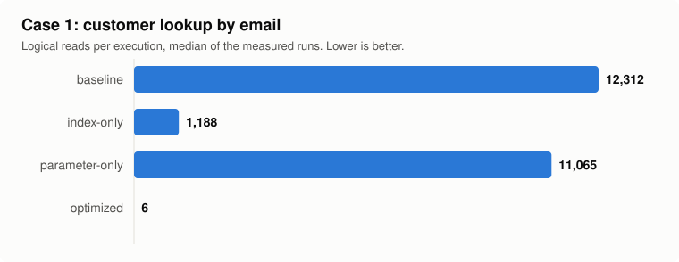
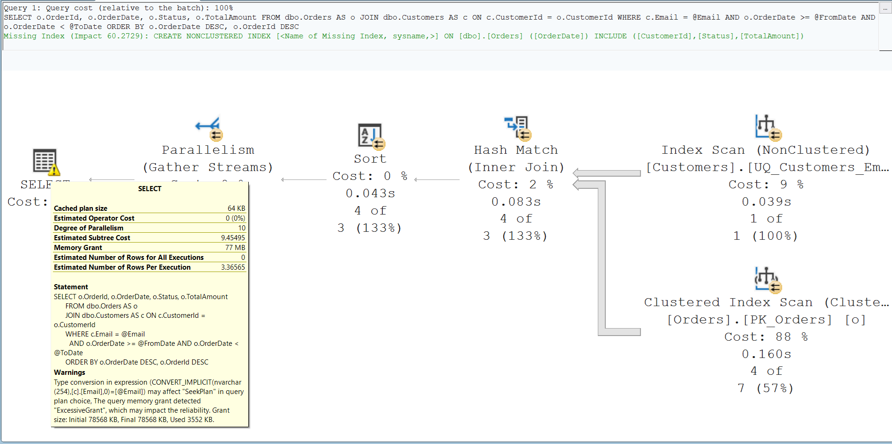
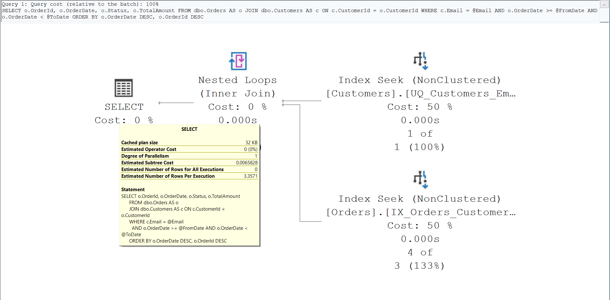

# SQL Server Performance Optimization Lab

A reproducible lab that shows how slow SQL Server queries, missing or misdesigned indexes, expensive joins and poorly behaving stored procedures are diagnosed and fixed — with measurements taken before and after every change.

> **Status:** case 1 is complete and measured. Cases 2 and 3 are in development. See [docs/roadmap.md](docs/roadmap.md).

## 1. Business problem

Applications that run fine at launch often slow down as data grows: pages time out, reports take minutes, and the database server's CPU stays high. The cause is rarely the hardware. It is usually a handful of queries that read far more data than they need — because of a missing index, a predicate that cannot use an index, a join order the optimizer misjudged, or a stored procedure whose cached plan suits one parameter and punishes the rest.

## 2. Solution overview

This lab recreates those problems on a synthetic order-management database (customers, products, orders, order items, payments) and fixes them the way a client engagement would:

1. Reproduce the slow behavior with a deterministic dataset.
2. Measure a baseline: elapsed time, CPU time and logical reads.
3. Read the actual execution plan and identify the root cause.
4. Apply the smallest effective fix: an index, a query rewrite, or a stored procedure change.
5. Prove the results are identical, then measure again with the same harness.
6. Document the trade-offs, such as write overhead, storage and maintenance.

## 3. Demonstrated capabilities

- Reading actual execution plans: scans vs. seeks, key lookups, spills, misestimates
- Index design: composite key order, covering and filtered indexes, statistics
- Sargable predicate rewrites and implicit-conversion fixes
- Join and aggregation tuning for reporting queries
- Keyset pagination and stored procedure tuning (parameter sensitivity, catch-all queries)
- Measurement discipline with `SET STATISTICS IO, TIME` and Query Store

## 4. Evidence and measurable results

Every number in this section comes from the benchmark harness in this repository ([benchmarks/results/](benchmarks/results/)), measured on SQL Server 2022 Developer Edition with 2 million orders and a warm cache. Logical reads are the median of 11 runs; times are the mean per execution in 2-second timed loops, including returning rows to the client. Nothing is estimated.

| # | Case study | Status | Baseline | Optimized |
|---|---|---|---|---|
| 1 | [Slow filtering and lookup query](docs/case-studies/case-01-filtering-lookup.md): implicit conversion and a missing foreign-key index | Done | 12,312 logical reads, 183 ms | 6 logical reads, 0.20 ms |
| 2 | Expensive joins and aggregation | Planned | — | — |
| 3 | Inefficient pagination / stored procedure | Planned | — | — |

Details: [docs/case-studies/](docs/case-studies/README.md)

## 5. Setup and reproduction

Requirements:

- SQL Server 2019 or later. Developer Edition is free for non-production use; LocalDB or Express work for functional runs, though measurements will differ. Published measurements are taken on SQL Server 2022 Developer Edition.
- `sqlcmd` command-line tools.
- A Bash shell. On Windows, use Git Bash.
- SQL Server Management Studio, or VS Code with the `mssql` extension, for viewing execution plans.

Steps:

1. Clone this repository and open a Bash shell in its folder.
2. Create the lab database with its schema and synthetic data:
   ```bash
   scripts/setup-lab.sh
   ```
   This builds the full dataset used for the published measurements (2 million orders, 6 million order lines); it took about 7 minutes on the reference machine. Add `--scale 1` for a small dataset in under a minute. The script connects to the local default instance with Windows authentication. For another server, set `SQLCMDSERVER` first, for example `export SQLCMDSERVER='(localdb)\MSSQLLocalDB'`. The last line of output is `== lab database PerfLab ready in <n> s`.
3. Check the setup (optional):
   ```bash
   bash tests/setup-lab-test.sh
   ```
   The last line of output is `== summary: 0 failure(s)`.

To start over, run `scripts/setup-lab.sh --reset`. This deletes all lab data.

On LocalDB, database files live in your user profile folder and are not removed when a LocalDB instance is deleted. If setup stops with Msg 5170 ("Cannot create file ... because it already exists"), move or delete the old files named in the message.

These steps were tested on SQL Server 2022 Developer Edition and on new LocalDB 2019 and 2025 instances, with Windows authentication. SQL authentication (`SQLCMDUSER`, `SQLCMDPASSWORD`) is supported by sqlcmd but not yet tested here. Schema and data generator details: [sql/README.md](sql/README.md).

## 6. Screenshots

**Case 1: logical reads per execution** (generated from [benchmarks/results/case-01-filtering-lookup.csv](benchmarks/results/case-01-filtering-lookup.csv) by `benchmarks/chart-case.py`):



**Case 1: actual execution plans.** Before: an implicit-conversion warning, an index scan on the email index and a full scan of `Orders` (the missing-index hint shows at the top). After: two index seeks.





## 7. Technical stack

T-SQL · Microsoft SQL Server · sqlcmd · Query Store · execution plan analysis

## 8. Scope and limitations

- The data is synthetic and generated deterministically. It contains no customer or production data.
- Measurements are taken on a single development machine. Absolute timings depend on hardware. Relative improvements and logical reads are the meaningful comparison.
- Scope is query-, index- and procedure-level tuning. Server configuration, high availability and hardware sizing are out of scope.

## Repository layout

| Path | Contents |
|---|---|
| `sql/` | Database setup, schema, data generator, and per-scenario baseline and optimized scripts |
| `benchmarks/` | Measurement harness and sanitized results |
| `tests/` | Result-equivalence and sanity checks |
| `samples/` | Small example outputs |
| `docs/` | Architecture, roadmap, case studies, release checklist |
| `assets/screenshots/` | Sanitized screenshots |
| `scripts/` | Lab setup (`setup-lab.sh`) and repository tooling (public-safety scan) |

## License

MIT. See [LICENSE](LICENSE).
