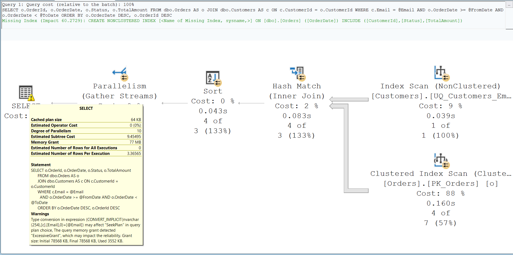
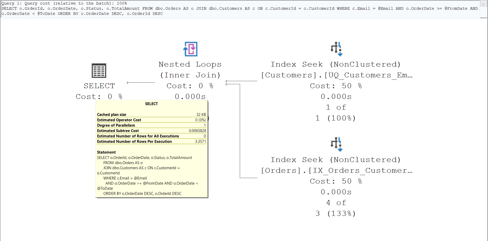

# Case 1: a customer lookup that read 12,312 pages to return 4 orders

**Result:** two small changes cut the query from 12,312 logical reads to 6. In 2-second timed loops, the mean time per execution fell from 183 ms to 0.20 ms. Neither change was enough on its own, and an automated test shows the results are identical. For customers with thousands of orders, the gain in reads holds, but the time gain is smaller, because returning the rows dominates (section 6).

All numbers come from the committed results in [benchmarks/results/](../../benchmarks/results/): [case-01-filtering-lookup.md](../../benchmarks/results/case-01-filtering-lookup.md) for the typical customer, plus the [high-volume](../../benchmarks/results/case-01-filtering-lookup-high-volume.md) and [wide-range](../../benchmarks/results/case-01-filtering-lookup-wide-range.md) parameter sets. Section 9 lists which statements are measured, which were checked by inspection, and which are interpretation.

## 1. Problem

> "The customer screen is slow. Looking up a customer's orders by email takes a noticeable moment, and the database server's CPU goes up whenever support staff are busy."

The screen runs one query: the orders of the customer with a given email, within a date range, newest first. The customer in this test has 4 orders in 2025, yet the query does far more work than 4 rows should need.

## 2. Reproduction steps

From a fresh clone with SQL Server 2019 or later and sqlcmd:

```bash
scripts/setup-lab.sh                                                       # scale 20, seed 42
bash benchmarks/run-case.sh sql/scenarios/case-01-filtering-lookup         # measure 4 variants
bash benchmarks/capture-plans.sh sql/scenarios/case-01-filtering-lookup    # save actual plans
bash tests/case-01-equivalence-test.sh                                     # prove identical results
```

Add `--conf benchmark-high-volume.conf` or `--conf benchmark-wide-range.conf` to the first two commands for the other parameter sets.

The query, as the application sends it ([baseline.sql](../../sql/scenarios/case-01-filtering-lookup/baseline.sql)):

```sql
EXEC sys.sp_executesql
    N'SELECT o.OrderId, o.OrderDate, o.Status, o.TotalAmount
      FROM dbo.Orders AS o
      JOIN dbo.Customers AS c ON c.CustomerId = o.CustomerId
      WHERE c.Email = @Email
        AND o.OrderDate >= @FromDate AND o.OrderDate < @ToDate
      ORDER BY o.OrderDate DESC, o.OrderId DESC;',
    N'@Email nvarchar(4000), @FromDate datetime2(0), @ToDate datetime2(0)',
    @Email = N'casey.stonebridge.150000@example.com', @FromDate = '2025-01-01', @ToDate = '2026-01-01';
```

Data: 200,000 customers and 2,000,000 orders. `Customers.Email` is `varchar(254)` with a unique constraint. `Orders.CustomerId` has a foreign key but no index.

## 3. Baseline metrics

SQL Server 2022 Developer Edition (16.0.4305.5), compatibility level 160, 20 logical CPUs, 32 GB memory, MAXDOP 10. Warm cache: one discarded warm-up run, then 11 measured runs and 3 timed loops. Median, with the range in brackets.

| Metric | Baseline |
|---|---|
| Rows returned | 4 |
| Logical reads | 12,312 |
| CPU time (`SET STATISTICS TIME`) | 594 ms (497–639) |
| Elapsed time (`SET STATISTICS TIME`) | 165 ms (148–179) |
| Mean elapsed per execution, 2-second timed loop | 183,108 µs (174,554–187,368) |

`SET STATISTICS TIME` reports whole milliseconds. The timed loop runs the query back to back for 2 seconds and divides the loop time by the number of executions; it includes returning the rows to the client.

CPU time is higher than elapsed time because the plan runs in parallel (degree of parallelism 10 in the actual plan).

## 4. Root-cause analysis

The actual execution plan shows two problems.

1. **Implicit conversion on the email column.** The plan carries a `PlanAffectingConvert` warning: `CONVERT_IMPLICIT(nvarchar(254),[c].[Email],0)=[@Email]`, issue "Seek Plan". The parameter is `nvarchar`, and the column is `varchar`. `nvarchar` has the higher data-type precedence, so the conversion is applied to the column, not to the parameter. Under this database's SQL collation, SQL Server then cannot seek the index, and the plan shows an **Index Scan** of `UQ_Customers_Email`, even though the email is unique. The index-only variant in section 6, which fixes the `Orders` side, still needs 1,188 logical reads.

   .NET's `SqlClient` sends a `string` parameter as `nvarchar` unless the code states another type. This is what `AddWithValue` does. The declared length depends on the value and the SqlClient version; this lab uses `nvarchar(4000)`, and the length does not change the conversion.
2. **No index for the join.** `Orders.CustomerId` has a foreign key, but SQL Server does not create indexes for foreign keys. The plan reads the whole `Orders` clustered index (2,000,000 rows) in a **Clustered Index Scan** and joins with a Hash Match. The plan also reports a missing-index suggestion for `Orders`, keyed on `OrderDate`, with `CustomerId` only as an included column.

The plan captured for the screenshot below also carried an `ExcessiveGrant` warning: 78,568 KB of memory granted, 3,552 KB used. Later captures did not reproduce it reliably. On the current lab, the typical customer's plan was granted 78,568 KB and used 4,128 KB without the warning, and the two high-volume parameter sets were granted 12,968 KB and used 7,936–8,304 KB. The cause of the variation was not established, so the memory grant is not part of this case's claims.



## 5. Optimization

Two changes, each the smallest one that removes its cause:

1. **Send the parameter with the column's type.** In the query this is `@Email varchar(254)` instead of `nvarchar(4000)` ([optimized.sql](../../sql/scenarios/case-01-filtering-lookup/optimized.sql)). In the application it is a one-line change:

   ```csharp
   // Before: AddWithValue sends nvarchar
   cmd.Parameters.AddWithValue("@Email", email);
   // After: the column's type and length
   cmd.Parameters.Add("@Email", SqlDbType.VarChar, 254).Value = email;
   ```

   With Entity Framework Core, map the property as non-Unicode: `.IsUnicode(false).HasMaxLength(254)`. This mapping was not tested in this repository.
2. **Add one index on Orders** ([index-create.sql](../../sql/scenarios/case-01-filtering-lookup/index-create.sql)):

   ```sql
   CREATE INDEX IX_Orders_CustomerId_OrderDate
       ON dbo.Orders (CustomerId, OrderDate)
       INCLUDE (Status, TotalAmount);
   ```

   `CustomerId` comes first because the query filters it by equality, and `OrderDate` second for the range. SQL Server's own suggestion keyed the index on `OrderDate`. An index keyed on the date can narrow the search only to the date range, which means every order in 2025 rather than one customer's orders. That suggested index was not measured here. The clustered key `OrderId` is also stored in the index, so the actual plan reads it backwards and needs no Sort. `Status` and `TotalAmount` are included so that no key lookup is needed.

The new plan is two Index Seeks joined by Nested Loops, serial, with no memory grant.



## 6. After metrics

The same harness, environment, data and parameters. Each fix was also measured on its own:

| Variant | Logical reads | CPU ms | Elapsed ms | Timed-loop mean |
|---|---|---|---|---|
| Baseline | 12,312 | 594 (497–639) | 165 (148–179) | 183,108 µs |
| Index only | 1,188 | 94 (62–109) | 97 (85–115) | 112,507 µs |
| Parameter type only | 11,065 | 503 (423–547) | 136 (127–161) | 154,297 µs |
| **Both changes** | **6** | **0** | **0** | **197 µs (195–205)** |

- **Both changes:** about 2,000 times fewer logical reads (12,312 → 6). `SET STATISTICS TIME` reported 0 ms CPU and 0 ms elapsed in all 11 runs, which only says "below its 1 ms resolution". The timed loops give the finer number: a mean of 197 µs per execution, including returning the 4 rows to the client.
- **Index only:** the join is fixed, but the email index is still scanned (1,188 reads).
- **Parameter type only:** the email lookup is a seek, but `Orders` is still scanned (11,065 reads).

### Other parameter sets

The fix was also measured for high-volume customer 3, which has 9,987 orders in total (the largest customer outside the ten high-volume accounts has 25):

| Parameter set | Rows | Logical reads, baseline → both changes | Timed-loop mean, baseline → both changes |
|---|---|---|---|
| Typical customer, 2025 | 4 | 12,312 → 6 | 183,108 µs → 197 µs |
| High-volume customer, 2025 | 3,295 | 12,312 → 24 | 223,766 µs → 37,230 µs |
| High-volume customer, 2023–2025 | 9,987 | 12,312 → 58 | 299,630 µs → 111,684 µs |

- Logical reads drop by more than 200 times in every set.
- Time improves much less when the query returns thousands of rows: about 6.0 times for 3,295 rows and 2.7 times for 9,987 rows. The timed loop includes returning the rows to the client. The remaining time grows with the row count while the reads stay small, so the rows themselves, not the lookup, are now the cost. That is an interpretation of these measurements, not a separate measurement.
- The actual plans for all three sets have the same shape after the fix: Nested Loops over two Index Seeks, serial, no memory grant, no warnings. The baseline plans keep the email index scan, the `Orders` scan and the conversion warning in all three.

### Result equivalence

`tests/case-01-equivalence-test.sh` compares the output of the baseline and optimized queries row by row, without and with the index, for six parameter sets:
- a range whose start and end are exact order timestamps
- a typical customer
- a high-volume customer over one year and over three years
- an email in upper case
- an unknown email

All 12 checks pass. To show that the test can fail, it was run against seven deliberately broken versions of the optimized query:

| Broken version | Caught |
|---|---|
| Ascending sort order | Yes |
| Start of range one day later | Yes |
| Start of range exclusive (`>` instead of `>=`) | Yes |
| End of range inclusive (`<=` instead of `<`) | Yes |
| Email parameter truncated (`varchar(10)`) | Yes |
| A changed output value | Yes |
| `OrderId` tie-breaker removed from the sort | **No** |

The last one cannot be caught with this data: a missing tie-breaker matters only when one customer has two orders with the same timestamp, and the test customers have none.

## 7. Trade-offs

- **Write cost and storage:** the new index holds a row for each of the 2,000,000 orders. Every insert, every delete and every update of `CustomerId`, `OrderDate`, `Status` or `TotalAmount` must also maintain it. Its size and its effect on writes were not measured here and should be checked against the real write load.
- **Fixing the parameter, not the column:** changing `Email` to `nvarchar` would also remove the conversion, but it rewrites the column and its index. `nvarchar` also stores two bytes per character, twice the bytes of `varchar` for these ASCII emails, unless row or page compression applies Unicode compression. Matching the parameter type changes no data.
- **Other callers:** every code path that queries `Email` with an `nvarchar` value still scans. Search the codebase for `AddWithValue` on that column, or use a non-Unicode mapping in the ORM, to fix them all.
- **Large results:** for customers with thousands of orders in range, returning the rows dominates the time after the fix (section 6). Paging or a narrower default date range would help those screens; neither was tested here.

## 8. Reproducibility notes

- **Data:** seed 42, scale 20. The generator is deterministic; `tests/data-generator-test.sh` proves identical data for the same seed and scale.
- **Collation:** the lab pins `SQL_Latin1_General_CP1_CI_AS`. One separate check on the same engine, with a throwaway database and table under `Latin1_General_CI_AS`, showed an Index Seek through the conversion (`GetRangeThroughConvert`). So the email scan depends on the collation, while the missing index on `Orders` does not. That check is not part of the automated tests.
- **Cache:** warm. Cold-cache runs were not measured.
- **Timings:** they depend on the hardware and varied between harness runs; logical reads did not, and are the main comparison.
- **Statistics:** the generator creates single-column statistics on every column and builds all statistics with `FULLSCAN`, so estimates do not depend on sampling. After the benchmark runs, no statistic in the lab database was sampled. An earlier build left the column statistics on `Orders.CustomerId` and `Orders.OrderDate` to SQL Server, which sampled them; the plan shapes and logical reads were the same on both builds.

## 9. Evidence status

| Statement | Status |
|---|---|
| Logical reads, CPU and elapsed times, timed-loop means, row counts | Measured: committed results in `benchmarks/results/` |
| Identical results of baseline and optimized queries | Measured: equivalence test, 12/12; the test caught 6 of 7 broken versions |
| Plan operators, conversion warning, missing-index suggestion, backward seek, no Sort, serial plan | Checked by inspection of the actual plans (screenshots above; `benchmarks/capture-plans.sh` recreates them) |
| Plan shape the same for all three parameter sets | Checked by inspection of the captured plans |
| A Windows collation seeks through the conversion | Checked once by hand; not automated |
| `ExcessiveGrant` warning and memory grant size | Varied between captures; not claimed |
| `SqlClient` sends strings as `nvarchar`; foreign keys get no automatic index; data-type precedence | Documented SQL Server and .NET behavior, not tested here |
| EF Core mapping, index write cost and size, cold-cache behavior, the effect of an `OrderDate` index | Not tested |
| Why the time stops improving for large results | Interpretation of the measurements |
